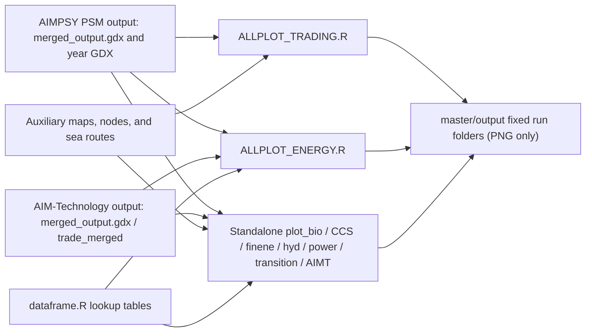

# AIMPSY plot environment structure audit

Audit date: 2026-07-15 (Asia/Tokyo)

## Executive summary

- The Git repository root is `AIMPSY_plot`, not `AIMPSY_plot/master`. Running `git rev-parse --show-toplevel` from either directory returns `AIMPSY_plot`.
- `master` is the current main R project. It contains 18 R scripts, 3 auxiliary data files, and 401 generated PNG files. All of these files are currently Git-tracked.
- The two principal entry points are [`master/code/ALLPLOT_ENERGY.R`](master/code/ALLPLOT_ENERGY.R#L1) and [`master/code/ALLPLOT_TRADING.R`](master/code/ALLPLOT_TRADING.R#L1). Individual `plot_*.R` files also execute plotting work when run or sourced.
- Current scripts do not receive a run directory as an argument. They embed model paths, scenario lists, years, and output directories in source code. The main PSM run ID observed in current code is `2606171718`; the supporting AIM-Technology run ID is `2606111707`.
- The observed run ID is a 10-digit timestamp token consistent with `YYMMDDHHMM`. Existing plot folders retain only the first six digits and use names such as `global_260617`, so the exact model run is not recoverable from the output path alone.
- The configured network paths for `2606171718` and `2606111707` were not present at audit time. The local OneDrive node and sea-route files were accessible. No plotting script was executed.
- R 4.4.3, the packages referenced by the scripts, and GAMS 26.1 are installed. All 18 R files pass static `parse()` validation. There is no `renv.lock`, `DESCRIPTION`, or other dependency lock file.
- Existing output is not ignored and is written to fixed paths. Re-running scripts can overwrite tracked PNGs. New automatic plotting must therefore use a new, non-existing run directory and must not run until input paths and scope have been confirmed.

## Audit method and limits

This audit used directory listings, Git inspection, text search, R package inspection, JSON/CSV schema inspection, path-existence checks, and static R parsing. It did not:

- edit `AIMPSY_AI`;
- execute model or plotting code;
- read GDX symbols, because the configured GDX paths no longer exist;
- overwrite or regenerate any data or figure;
- commit or push changes.

The local model repository was confirmed at `../AIMPSY_AI` on branch `develop`, commit `884e3898bd694f8021c98786a0238c528bc70683`. Its `outputs` directory was empty at audit time. The plotting code does not read that local directory; it points to a network share instead.

`AIMPSY_AI` was clean when this audit began. During the audit, three unrelated untracked files (`AGENTS_DRAFT.md`, `MODEL_PLOT_INTERFACE.md`, and `MODEL_STRUCTURE_AUDIT.md`) appeared there from concurrent work. This plot-side task did not create, edit, or remove them; they were left untouched.

## Git repository boundary

| Item | Result |
|---|---|
| Repository root | `C:/@Research_Workplace/300_AIMPSY-with-AI/AIMPSY_plot` |
| Branch at audit start | `main` |
| HEAD at audit start | `9f491c7da805dff13b8c3199a8c3ba9312cfc684` |
| `git -C master rev-parse --show-toplevel` | Same outer `AIMPSY_plot` root |
| Tracked files below `master` | 423 |
| Separate model repository | `C:/@Research_Workplace/300_AIMPSY-with-AI/AIMPSY_AI` |

An empty `master/.git/` directory is present, but it contains no repository control files and does not create a nested Git boundary. Git operations and final diff checks must be run at `AIMPSY_plot` root.

## Repository-wide directory structure

```text
AIMPSY_plot/                         Git root
├─ .agents/                          empty
├─ .vscode/                          editor settings
├─ IntermReport/                     older/intermediate R project (5 R files)
├─ kyoeiken/                         separate analysis variant (7 R files)
├─ master/                           current main R project (18 R files)
│  ├─ .agents/                       empty
│  ├─ .Rproj.user/                   ignored RStudio state
│  ├─ code/                          data transformation and plot scripts
│  ├─ data/                          auxiliary CSV/GeoJSON data
│  ├─ output/                        401 tracked PNG outputs
│  └─ master.Rproj
├─ softlink/                         older soft-link analysis variant (8 R files)
└─ TR_world/                         older world/transition project (6 R files)
```

The top-level projects share similar names and legacy helper files but are not connected by `source()` calls from `master`. This audit treats `master` as the active project and the other directories as historical or specialized variants; their status should be confirmed by the project owner before consolidation.

## Role of `master`

`master` is both the active RStudio project and the main analysis working directory. Scripts generally try to resolve `project_dir` to `master`, for example in [`ALLPLOT_ENERGY.R`](master/code/ALLPLOT_ENERGY.R#L13-L26). It is not a separate Git repository. Its current contents are:

| Area | Current contents | Git status |
|---|---:|---|
| `master/code` | 18 R files, 372,179 bytes | all 18 tracked |
| `master/data` | 1 CSV and 2 GeoJSON files | all 3 tracked |
| `master/output` | 401 PNG files, about 344 MB | all 401 tracked |
| `master/master.Rproj` | RStudio project, UTF-8 | tracked |

## Script inventory

| Script | Role and execution behavior | Main inputs | Main outputs / side effects |
|---|---|---|---|
| `ALLPLOT_ENERGY.R` | Principal integrated regional-summary entry point. Reads AIM-Technology and PSM data, link/carrier/biomass/CCS data, then creates paginated multi-panel summaries. | `iamc_gdx`, `vff_l`, `vfb_l`, `vp_l`, `pmax`, R272 map; sources `dataframe.R`. | `<base>/<scenario>/plot_all/global_<scenario>_regional_summary_page_<n>.png` at [lines 1611-1632](master/code/ALLPLOT_ENERGY.R#L1611-L1632). |
| `ALLPLOT_TRADING.R` | Principal trading/network orchestrator. Establishes shared paths and caches, loads map/node data, then sources four scripts sequentially. | PSM year GDX, merged GDX, node and sea-route data. | All outputs of `plot_link.R`, `plot_trade.R`, `plot_trade_diff.R`, and `plot_network.R`; order at [lines 227-240](master/code/ALLPLOT_TRADING.R#L227-L240). |
| `dataframe.R` | Shared IAMC variable/legend/color lookup tables for primary, secondary and final energy, emissions, costs, capacity, and related series. | None; requires `tibble::tribble` to be available in the caller. | Objects in the caller/global environment; no files. |
| `data_list.R` | One-line legacy placeholder containing only `data`. | An object named `data` would have to exist. | No useful standalone output; running it in a clean session would fail. |
| `plot_bio.R` | Standalone biomass-balance plots by region and all regions. | AIM-Technology/PSM `iamc_gdx`, PSM `vff_l`, `vfb_l`, `vp_l`, R272 map. | `<scenario>/plot_bio/*biomass_balance*.png` at [lines 770-803](master/code/plot_bio.R#L770-L803). |
| `plot_CCS.R` | Standalone CCS storage potential/use plots. | PSM `pmax`, `vp_l`, R272 map. | `<scenario>/plot_CCS/*CCS_storage*.png` at [lines 477-511](master/code/plot_CCS.R#L477-L511). |
| `plot_finene.R` | AIM-Technology final-energy scenario comparisons. | AIM-Technology `iamc_gdx`; sources `dataframe.R`. | `scenario_anarysis/plot_finene/*.png` at [lines 24-30](master/code/plot_finene.R#L24-L30) and [166-173](master/code/plot_finene.R#L166-L173). |
| `plot_hyd.R` | Standalone H2/NH3/synthetic-fuel balance plots. | AIM-Technology/PSM `iamc_gdx`, PSM `vff_l`, `vfb_l`, R272 map. | `<scenario>/plot_hydrogen/*hydrogen_balance*.png` at [lines 758-779](master/code/plot_hyd.R#L758-L779). |
| `plot_link.R` | AC and H2 link capacity/flow maps plus demand maps and demand-link overlays. | PSM year GDX `vff_l`, `vfb_l`, `vfs_l`; merged `iamc_gdx`; node coordinates. | Scenario `plot_link_ele` / `plot_link_h2` subtrees; save sites at [lines 552-623](master/code/plot_link.R#L552-L623) and [829-869](master/code/plot_link.R#L829-L869). |
| `plot_network.R` | Integrated H2, NH3, and synthetic-fuel network maps. | PSM year GDX, merged `iamc_gdx`, nodes, sea routes; reuses region-map code from `plot_trade.R`. | `<scenario>/plot_network/*.png` at [lines 919-1006](master/code/plot_network.R#L919-L1006). |
| `plot_power.R` | Broad power-system plot suite and cross-scenario comparisons: power, capacity, curtailment, capacity factors, transmission, hydrogen. | PSM and AIM-Technology `iamc_gdx`. | Multiple scenario plot folders and `scenario_anarysis/*`; output locations begin at [line 189](master/code/plot_power.R#L189) and comparison output at [line 660](master/code/plot_power.R#L660). |
| `plot_trade.R` | Maritime NH3 and biomass trade maps, demand maps, and overlays. | PSM `vff_l`, `vfb_l`, merged `iamc_gdx`, representative ports and sea routes. | `<scenario>/plot_trade_nh3` and `plot_trade_bio`; save loop at [lines 693-747](master/code/plot_trade.R#L693-L747). |
| `plot_trade_AIMT.R` | AIM-Technology trade maps using `trade_merged`. It is not included by `ALLPLOT_TRADING.R`. | AIM-Technology `trade_merged`, PSM merged `iamc_gdx`, sea routes. | Dynamically targets `output/global_<YYMMDD>_AIMT`; maps saved at [lines 639-690](master/code/plot_trade_AIMT.R#L639-L690). |
| `plot_trade_diff.R` | Scenario-minus-baseline differences for NH3/biomass transport and link capacity. | PSM year GDX `vff_l`, `vfb_l`, `vfs_l`, map/node/route data. | `scenario_anarysis/<plot family>/difference_from_<base>/*.png` at [lines 843-954](master/code/plot_trade_diff.R#L843-L954). |
| `plot_transition.R` | Paginated power-generation and capacity transitions over 2020-2050. | PSM/AIM-Technology `iamc_gdx`; sources `dataframe.R`. | `<scenario>/plot_transition/*.png` at [lines 348-361](master/code/plot_transition.R#L348-L361). |
| `worldmap_plot.R` | Standalone R31 region map/boundary and NH3 node-coordinate generator. The directory resolution still assumes the older `softlink` project. | Natural Earth package data and any existing node CSV. | Writes three PNGs and rewrites a node CSV at [lines 224-256](master/code/worldmap_plot.R#L224-L256) and [352-356](master/code/worldmap_plot.R#L352-L356). Do not automate without approval. |
| `define/var.R` | Legacy dispatch/capacity variable, legend, color, and sign tables. | `tibble::tribble` from a caller. | Objects only; no current `master` script sources it. |
| `inc_plog/func_analysis.R` | Legacy hourly/daily dispatch and generation-mix functions. Relies on many global objects (`df`, `odir`, flags, plot styles). | Caller-created global data and `CairoPNG`. | Legacy `odir/plot/...` PNGs; no current `master` entry point sources it. |

## Main execution flows and dependencies



Direct source/text dependencies are:

- `ALLPLOT_ENERGY.R` -> `dataframe.R` ([line 26](master/code/ALLPLOT_ENERGY.R#L26)).
- `plot_finene.R` -> `dataframe.R` ([line 22](master/code/plot_finene.R#L22)).
- `plot_transition.R` -> `dataframe.R` ([line 26](master/code/plot_transition.R#L26)).
- `ALLPLOT_TRADING.R` -> `plot_link.R` -> `plot_trade.R` -> `plot_trade_diff.R` -> `plot_network.R`, by sequential `source()` ([lines 227-240](master/code/ALLPLOT_TRADING.R#L227-L240)). Shared objects are intentionally inherited through the global environment.
- `plot_network.R` reads and evaluates the region-boundary function block from `plot_trade.R` when the orchestrator has not already supplied it ([lines 78-108](master/code/plot_network.R#L78-L108)). This is a fragile textual dependency rather than a module API.
- `define/var.R`, `inc_plog/func_analysis.R`, and `data_list.R` are not referenced by the current main flows.

Most plot scripts contain top-level loops, so `source()` is execution, not merely function loading. There is no `main()` guard or dry-run mode.

## Data flow from `master/data` to `master/output`

`master/data` is auxiliary, not the main model-results landing area:

| File | Size / shape | Schema and observed use |
|---|---:|---|
| `AIM_R31_NH3_trade_nodes.csv` | 960 bytes | Columns `N_PSY`, `lon`, `lat`; fallback node coordinates in `plot_link.R` and `plot_trade_diff.R`. |
| `searoute.geojson` | 2,641,852 bytes; 961 LineStrings | Routes with `R31_from`, `R31_to`, terminal fields, `length_km`, `duration_hours`, and `route_source`. A local copy exists, but current main scripts default to the OneDrive copy rather than this file. |
| `searoute_r31_representative.geojson` | 11,198 bytes; 31 Points | One representative port/node per R31 region. A local copy exists, but current main scripts default to the OneDrive copy. |

The normal plot flow is therefore direct network GDX -> in-memory tibble/sf -> PNG. There is no current copy, link, or conversion step from `AIMPSY_AI` into `master/data`, and no immutable staged model-data directory.

## Model-to-plot data flow

Current PSM references are constructed from:

```text
\\SY_3600_01\atfs02\Individual\hsakata\AIMPSY\output\
  global_softlink_Sc\Global\2606171718\
  ├─ main\merged_output.gdx
  └─ gams_output\gdx_primary\<scenario>\2050.gdx
```

The integrated energy path is explicit at [`ALLPLOT_ENERGY.R:35-38`](master/code/ALLPLOT_ENERGY.R#L35-L38); trading scripts construct the same layout from `scenario_group`, `region`, and `date`, for example [`plot_trade.R:34-38`](master/code/plot_trade.R#L34-L38) and [`plot_trade.R:125-127`](master/code/plot_trade.R#L125-L127).

Supporting AIM-Technology data is read directly from:

```text
\\SY_3600_01\atfs02\Individual\hsakata\AIMEnduse\output\softlink_Sc\2606111707\main\merged_output.gdx
```

This is a second external model/output dependency, not part of the local `AIMPSY_AI` repository.

## GDX and variable interface

The observed GDX symbols are:

| Symbol | Use |
|---|---|
| `iamc_gdx` | Scenario/region/variable/year/value model summaries. Converted from `Sc`, `Sr`, `Sv`, `Y5`, and `iamc_gdx` to an R table at [`ALLPLOT_ENERGY.R:59-77`](master/code/ALLPLOT_ENERGY.R#L59-L77). |
| `vff_l`, `vfb_l` | Directional link, carrier, biomass, NH3, and synthetic-fuel flows in year-specific GDX files. |
| `vfs_l` | Link/transport capacity used by link plots and scenario differences. |
| `vp_l` | Technology/link activity used for biomass and CCS use. |
| `pmax` | CCS storage potential. |
| `trade_merged` | AIM-Technology maritime trade data in `plot_trade_AIMT.R`. |

The complete IAMC variable catalog used for labels/colors is in `dataframe.R`; plot-specific subsets are declared in each script. Units are not transported in a dedicated column by the current readers. They are embedded in variable conventions, plot labels, and conversion constants such as `gwh_to_ej`, `twh_to_ej`, and `time_slice_hours` at [`ALLPLOT_ENERGY.R:41-45`](master/code/ALLPLOT_ENERGY.R#L41-L45) and [`plot_trade.R:134-138`](master/code/plot_trade.R#L134-L138).

## Package and runtime dependencies

Static inspection and the current R installation produced:

| Package | Installed version | Main purpose |
|---|---:|---|
| dplyr | 1.1.4 | transformation |
| tidyr | 1.3.1 | reshaping/grids |
| stringr | 1.5.1 | node/variable parsing |
| tibble | 3.2.1 | specification tables |
| ggplot2 | 4.0.0 | plots |
| gdxrrw | 1.0.6 | GDX input |
| patchwork | 1.3.0 | multi-panel pages |
| purrr | 1.0.4 | mapping/list workflows |
| sf | 1.0-21 | spatial objects/maps |
| rnaturalearth | 1.1.0 | country geometry |
| rnaturalearthdata | 1.0.0 | Natural Earth data |
| scales | 1.4.0 | map/axis scales |
| tidyverse | 2.0.0 | used by `worldmap_plot.R` |
| Cairo | 1.6-2 | legacy `CairoPNG` functions |

R is 4.4.3 UCRT. `C:/GAMS/win64/26.1` exists; `C:/GAMS/38` does not. Trading scripts actively call `igdx()` after checking both locations ([`ALLPLOT_TRADING.R:29-34`](master/code/ALLPLOT_TRADING.R#L29-L34)), but the same initialization is commented out in `ALLPLOT_ENERGY.R` ([lines 28-33](master/code/ALLPLOT_ENERGY.R#L28-L33)). A clean-session run of the energy entry point may therefore depend on external GDXRRW configuration.

There is no package lock or scripted environment bootstrap. Installed versions above describe this machine only, not a reproducible requirement set.

## Output figure inventory

All 401 files below `master/output` are PNGs and are Git-tracked:

| Existing folder | Files | Approximate bytes | Naming tendency |
|---|---:|---:|---|
| `global_260527` | 194 | 155,829,137 | global prefix + 6-digit date; legacy `300C*` scenarios and `scenario_anarysis` |
| `global_260527_AIMT` | 20 | 17,526,592 | date + model suffix; AIM-Technology trade maps |
| `global_260617` | 187 | 170,610,041 | global prefix + 6-digit date; `NPi500*` scenarios and `scenario_anarysis` |

Common figure families are `plot_all`, `plot_bio`, `plot_CCS`, `plot_capacity`, `plot_CF`, `plot_eleuse`, `plot_finene`, `plot_hydrogen`, `plot_link_ele`, `plot_link_h2`, `plot_network`, `plot_power`, `plot_trade_bio`, `plot_trade_nh3`, `plot_transition`, and `plot_transmission`.

There are no `run_metadata.yaml`, `tables`, or `logs` artifacts in current run folders. The misspelling `scenario_anarysis` is part of the existing path contract and must not be renamed during a minimal migration.

## Run ID handling and current naming

- Model paths use 10 digits: PSM `2606171718`, AIM-Technology `2606111707`.
- Current output names use a 6-digit date: `global_260617`, losing hour and minute.
- Current code uses literal values or constructs the folder from `substr(date, 1, 6)` in [`plot_trade_AIMT.R:23-30`](master/code/plot_trade_AIMT.R#L23-L30).
- Current output directories contain no metadata tying them to a source path, commit, scenario selection, or verification result.
- The exact producer-side validation of `YYMMDDHHMM` is not present in this repository. It should be confirmed and exported by the model workflow.

The recommended rule is documented in [`OUTPUT_NAMING_PROPOSAL.md`](OUTPUT_NAMING_PROPOSAL.md): `<10-digit-model-run-id>_<change-tag>`.

## Hard-coded paths and environment dependencies

| Dependency | Examples | Risk |
|---|---|---|
| Network model output | [`ALLPLOT_ENERGY.R:35-38`](master/code/ALLPLOT_ENERGY.R#L35-L38) | Configured runs and even the network output root were not present at audit time. |
| OneDrive maps/nodes | [`ALLPLOT_TRADING.R:40-44`](master/code/ALLPLOT_TRADING.R#L40-L44) | User-specific path. Files were accessible on this machine, but not portable. |
| GAMS installation | [`ALLPLOT_TRADING.R:29-34`](master/code/ALLPLOT_TRADING.R#L29-L34) | Version/location specific. |
| Fixed output folder | [`ALLPLOT_TRADING.R:38`](master/code/ALLPLOT_TRADING.R#L38), [`ALLPLOT_ENERGY.R:46`](master/code/ALLPLOT_ENERGY.R#L46) | Re-run can overwrite tracked figures. |
| Working directory | `plot_trade_AIMT.R`, `worldmap_plot.R`, parts of legacy code | Relative paths can target the wrong project. |
| Global environment sharing | `ALLPLOT_TRADING.R` and sourced scripts | Order-dependent behavior and name collisions. |
| Text extraction/eval | [`plot_network.R:78-108`](master/code/plot_network.R#L78-L108) | Breaks when source layout changes. |

`worldmap_plot.R` deserves special caution: from `master`, its current logic sets `softlink_dir` to the relative directory `softlink`, not `master` ([lines 10-16](master/code/worldmap_plot.R#L10-L16)). It then creates directories and writes a CSV. It is not safe to execute automatically until its intended project root is clarified.

## Reproducibility and safety risks

1. **Unavailable configured inputs:** current hard-coded model and R272 paths do not exist, so the main entry points cannot reproduce the tracked figures as configured.
2. **Silent overwrite:** `ggsave()` writes fixed filenames and directories; existing output is tracked and not ignored.
3. **Lost run precision:** output folder names retain only `YYMMDD`, while model paths use `YYMMDDHHMM`.
4. **No metadata:** figures do not record commits, exact input paths, scripts, units, or validation status.
5. **No dependency lock:** installed packages may drift, and ggplot output can change across versions.
6. **Top-level execution:** sourcing a plot file can immediately read large GDX files and generate many PNGs.
7. **Global-state coupling:** the trading orchestrator changes the working directory and injects shared objects into the global environment.
8. **Unit contract is implicit:** no unit column is retained by readers; conversions and labels are script-specific.
9. **Multiple project variants:** similarly named code in `IntermReport`, `kyoeiken`, `softlink`, `TR_world`, and `master` creates selection risk.
10. **RStudio workspace defaults:** `master.Rproj` uses default restore/save/history behavior rather than explicitly disabling workspace restoration.

## Git-managed files, generated files, and `.gitignore`

The root `.gitignore` contains only:

```gitignore
.Rproj.user
.Rhistory
.RData
.Ruserdata
```

Assessment:

- RStudio state is appropriately ignored.
- `master/output` is not ignored; all 401 current PNGs are tracked.
- The current repository policy therefore treats at least some generated figures as versioned deliverables.
- Do not add a blanket `output/` ignore rule without deciding whether existing tracked figures remain authoritative.
- A future policy can ignore only new run-scoped generated directories, but that is a repository-wide behavior change and should be approved separately.

## Existing `.agents` and Skills

Both `AIMPSY_plot/.agents/` and `AIMPSY_plot/master/.agents/` are empty. No plot-specific Skill or active `AGENTS.md` exists. [`AGENTS_DRAFT.md`](AGENTS_DRAFT.md) is the proposed repository instruction file and is intentionally not activated automatically by this audit.

## Automation boundary

Safe without additional approval, provided no files are written:

- Git status/diff/log inspection from `AIMPSY_plot` root;
- static code search and `parse()` validation;
- package/version and path-existence checks;
- reading CSV/GeoJSON schemas and GDX metadata/symbol lists if the input is accessible;
- planning a new output path and preparing metadata without creating figures.

Require human approval:

- executing any script whose fixed output path already exists;
- running `ALLPLOT_ENERGY.R`, `ALLPLOT_TRADING.R`, `plot_power.R`, or other multi-scenario/bulk generators;
- reading or processing a large model run when expected duration/output volume is not known;
- rewriting `master/data`, especially by `worldmap_plot.R`;
- copying, moving, linking, or converting model outputs;
- deleting, moving, or renaming existing outputs;
- changing `.gitignore` output policy;
- installing/upgrading packages, changing GAMS, committing, or pushing;
- any edit in `AIMPSY_AI`.

## Unknown items

- The current valid PSM and AIM-Technology output roots and run IDs.
- Whether the network share is retired, temporarily unavailable, or mounted under a different name.
- The producer-side definition and validation rule for the 10-digit run ID.
- Completion markers/checksums proving a model run is ready for plotting.
- Authoritative units for every `iamc_gdx`, `v*_l`, `pmax`, `vp_l`, and `trade_merged` variable.
- Whether the local `master/data` GeoJSON files should replace the OneDrive defaults.
- Which top-level project variants remain active.
- Whether tracked PNGs are formal deliverables or historical generated artifacts.
- Expected runtime and figure count for each entry point on a current run.

## Recommended minimal improvements

Can be done without moving existing code/data/output:

1. Adopt the output naming and metadata contract in `OUTPUT_NAMING_PROPOSAL.md` for all new runs.
2. Before any R execution, require an explicit input manifest: PSM run path, supporting AIM-Technology path, scenarios, years, regions, units, scripts, and a new non-existing output directory.
3. Add a lightweight preflight script in a later change that validates paths, packages, GDX symbols, and output non-existence without plotting.
4. Parameterize input and output paths through command-line arguments or one YAML configuration file while retaining current defaults during migration.
5. Point sea-route defaults to the tracked `master/data` copies after verifying byte/content equivalence and intended authority.
6. Make GDX initialization explicit and consistent for both entry points.
7. Add `renv` or another dependency lock only as a separate approved environment change.

Defer because they change structure or behavior:

- moving legacy top-level projects;
- renaming `scenario_anarysis`;
- reorganizing existing output into `figures/tables/logs`;
- untracking or deleting historical PNGs;
- refactoring all scripts into packages/modules;
- changing producer-side model outputs or the `AIMPSY_AI` repository.

## Model-side handoff proposal

Request the model owner to provide, without changing plot code yet:

1. the current canonical model output root and one valid 10-digit run ID;
2. a stable run layout containing `main/merged_output.gdx` and `gams_output/gdx_primary/<scenario>/<year>.gdx`, or a documented replacement;
3. a run-complete marker and machine-readable manifest listing scenarios, years, regions, symbols, dimensions, and units;
4. explicit notification of changes to `iamc_gdx`, `vff_l`, `vfb_l`, `vfs_l`, `vp_l`, or `pmax`;
5. confirmation of the authoritative R272 node-to-region mapping path;
6. source commit and verification status associated with each published run.
